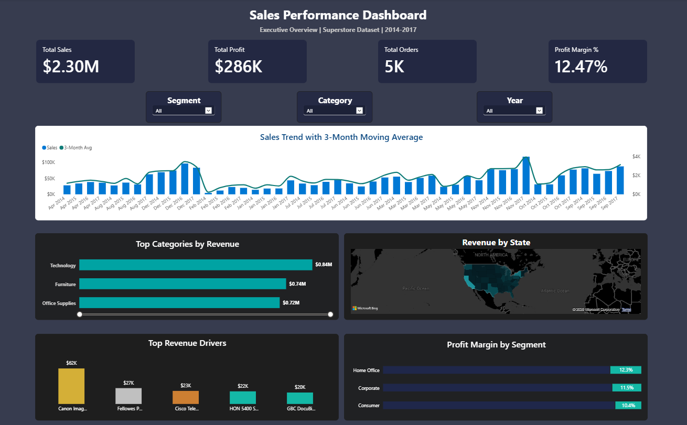
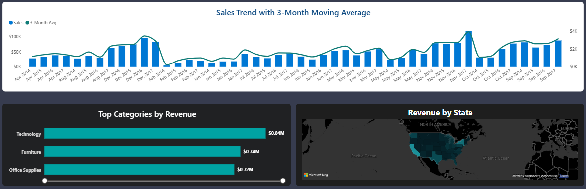
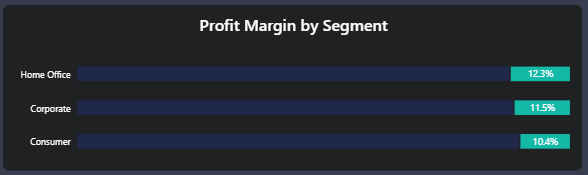

# Power BI Superstore Sales Dashboard

## Highlights
- $2.30M Total Sales
- $286K Total Profit
- 12.47% Profit Margin
- Interactive filtering by Category, Segment, and Year
- Regional and Product Performance Analysis
## Overview
This Power BI dashboard analyzes $2.3M in sales data to provide executive-level insights into revenue, profitability, customer segments, product performance, and regional trends. The solution enables business leaders to quickly identify growth opportunities and profitability drivers through interactive visualizations.
## Business Objective
The goal of this dashboard is to help business leaders:
- Monitor key sales and profit metrics
- Identify top-performing products and categories
- Analyze regional performance
- Track profitability trends over time
- Explore customer segment behavior
## Dashboard Features
### Executive KPIs
- Total Sales
- Total Profit
- Profit Margin %
- Total Orders
### Interactive Analysis
- Category Performance
- Sub-Category Analysis
- Regional Analysis
- Segment Analysis
- Time-Series Trends
### Filtering
Users can filter results by:
- Year
- Segment
- Category
- Region
## Tools Used
- Power BI Desktop
- Power Query
- DAX Measures
- Data Modeling
- Data Visualization
- Business Intelligence Reporting
## Technical Highlights
- Built a star-schema data model
- Created DAX measures for Sales, Profit, Profit Margin, and Order Metrics
- Implemented interactive slicers and cross-filtering
- Developed KPI scorecards for executive reporting
- Designed responsive and user-friendly dashboard layouts
## Key DAX Measures
- Profit Margin % = DIVIDE([Total Profit], [Total Sales], 0)
- Total Sales = SUM(Orders[Sales])
- Total Profit = SUM(Orders[Profit])
## Dataset
- Dataset: Superstore Sales Dataset
- Source: https://www.kaggle.com/
- Dataset is used for educational and portfolio purposes

## Dashboard Preview
### Executive Overview

### Sales Analysis

### Profit Analysis

## Business Insights & Recommendations
### Key Findings
- Technology generated the highest sales revenue across all categories.
- Profitability varied significantly by product category, indicating opportunities for margin improvement.
- Regional performance showed distinct growth patterns, suggesting the need for region-specific sales strategies.
- Several sub-categories delivered strong sales volume but below-average profit margins.
### Business Recommendations
- Focus marketing and inventory investments on high-performing technology products.
- Review pricing and cost structures for low-margin sub-categories.
- Allocate resources toward regions demonstrating strong growth potential.
- Monitor both sales and profit metrics to ensure revenue growth translates into sustainable profitability.
## Skills Demonstrated
- Dashboard Design
- Data Modeling
- DAX Measures
- KPI Development
- Business Analysis
- Executive Reporting
- Data Storytelling
## Author
Susan Wang
- Business Analyst | Operational Risk Professional | Power BI Developer
- GitHub: https://github.com/susanhwang
